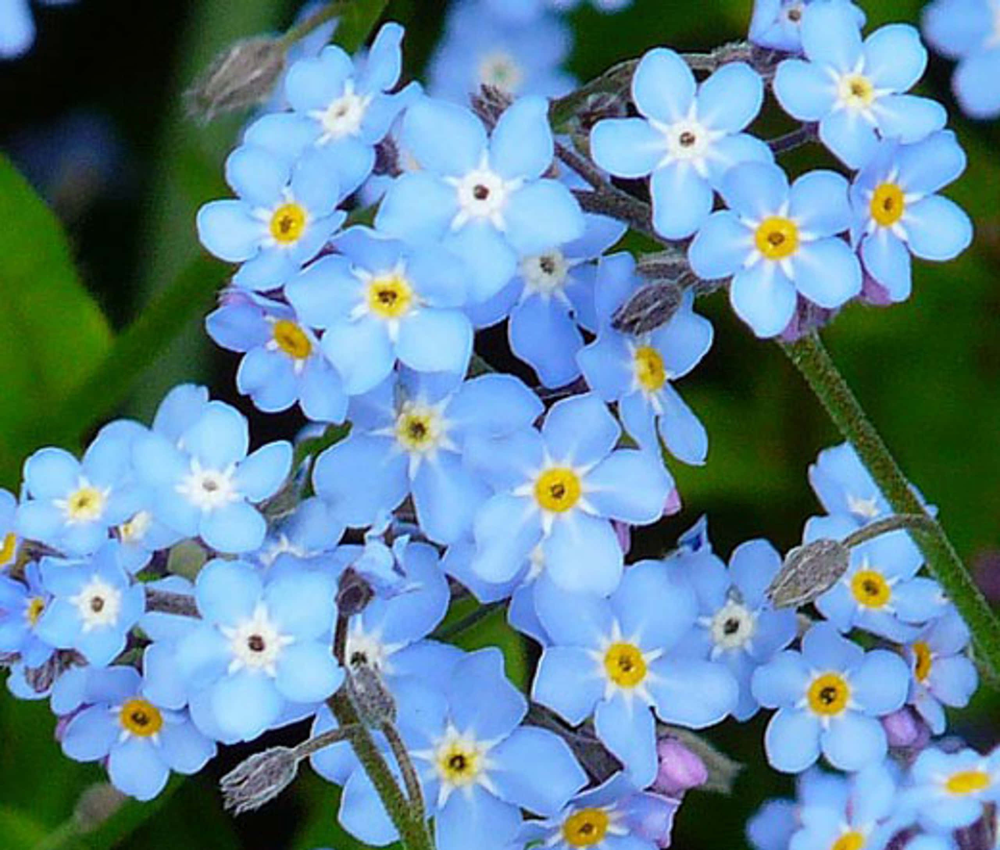
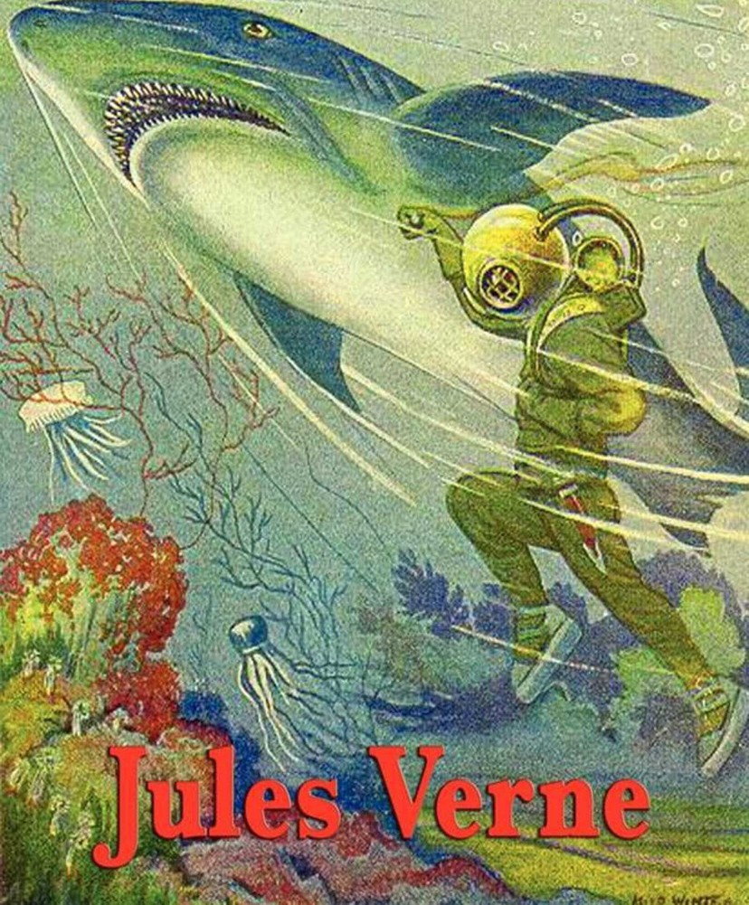
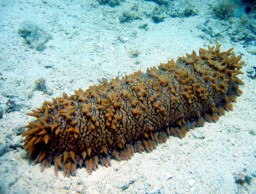
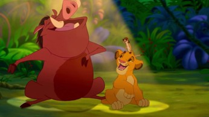
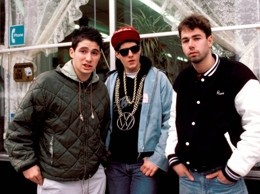
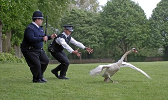
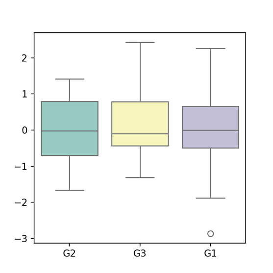
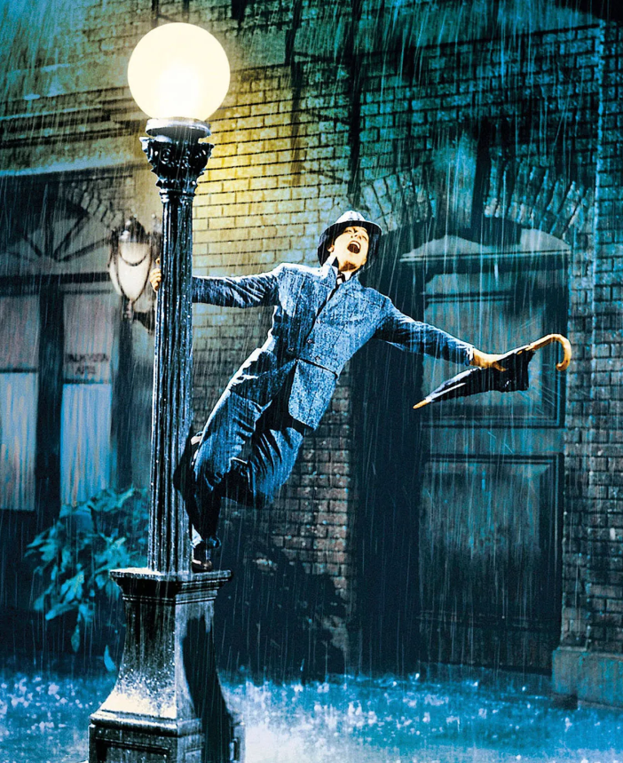

## {.vertical}

**Example**

::::{.columns}

::: {.column style="width: 50%; text-align: center;"}
Display popularised by Tukey that keeps the raw digits visible
:::

::: {.column width="50%"}

:::
::::

**ANSWER:** Stem and Leaf Plot / Forget-Me-Not

## {.vertical}

**Question 1**

::::{.columns}

::: {.column style="width: 50%; text-align: center;"}
Iterative optimiser that steps in the direction of steepest decrease.
:::

::: {.column width="50%"}
{width="100%"}
:::
::::

::: {.score}
[1 point for a correct answer]
:::

::: {.footer}
A. Rhyme Time
:::

## {.vertical}

**Question 2**

::::{.columns}

::: {.column style="width: 50%; text-align: center;"}
Fisher's famous experiment on whether milk was poured in first.
:::

::: {.column width="50%"}
{width="80%"}
:::
::::

::: {.score}
[1 point for a correct answer]
:::

::: {.footer}
A. Rhyme Time
:::

## {.vertical}

**Question 3**

::::{.columns}

::: {.column style="width: 50%; text-align: center;"}
Theorem guaranteeing the sample mean converges to the population mean.
:::

::: {.column width="50%"}
{width="60%"}
{width="60%"}
:::
::::

::: {.score}
[1 point for a correct answer]
:::

::: {.footer}
A. Rhyme Time
:::

## {.vertical}

**Question 4**

::::{.columns}

::: {.column style="width: 50%; text-align: center;"}
Fitting method published by Legendre in 1805, though Gauss claimed he'd been using it for years.
:::

::: {.column width="50%"}
Fairy tale in which the porridge is "just right".
:::
::::

::: {.score}
[1 point for a correct answer]
:::

::: {.footer}
A. Rhyme Time
:::

## {.vertical}

**Question 5**

::::{.columns}

::: {.column style="width: 50%; text-align: center;"}
The hidden details stored with a photo, such as when it was taken, the camera model and the GPS location.
:::

::: {.column width="50%"}
{width="100%"}
:::
::::

::: {.score}
[1 point for a correct answer]
:::

::: {.footer}
A. Rhyme Time
:::

## {.vertical}

**Question 6**

::::{.columns}

::: {.column style="width: 50%; text-align: center;"}
\_\_\_-\_\_\_ lower bound
:::

::: {.column width="50%"}
An Adelaide-born Fields Medallist
:::
::::

::: {.score}
[1 point for a correct answer]
:::

::: {.footer}
A. Rhyme Time
:::

## {.vertical}

**Question 7**

::::{.columns}

::: {.column style="width: 50%; text-align: center;"}
The random error that creeps into every sensor reading, which a Kalman filter tries to smooth out.
:::

::: {.column width="50%"}
{width="100%"}
:::
::::

::: {.score}
[1 point for a correct answer]
:::

::: {.footer}
A. Rhyme Time
:::

## {.vertical}

**Question 8**

::::{.columns}

::: {.column style="width: 50%; text-align: center;"}
The set of all possible outcomes of a random experiment.
:::

::: {.column width="50%"}
{width="100%"}
:::
::::

::: {.score}
[1 point for a correct answer]
:::

::: {.footer}
A. Rhyme Time
:::

## {.vertical}

**Question 9**

::::{.columns}

::: {.column style="width: 50%; text-align: center;"}
{width="100%"}
:::

::: {.column width="50%"}
{width="100%"}
:::
::::

::: {.score}
[1 point for a correct answer]
:::

::: {.footer}
A. Rhyme Time
:::

## {.vertical}

**Question 10**

::::{.columns}

::: {.column style="width: 50%; text-align: center;"}
Random process where the next state depends only on the current state, not on how it got there.
:::

::: {.column width="50%"}
{width="80%"}
:::
::::

::: {.score}
[1 point for a correct answer]
:::

::: {.footer}
A. Rhyme Time
:::

## {.center style="text-align: center;"}

End of Round A

[← Back to all rounds](index.html)