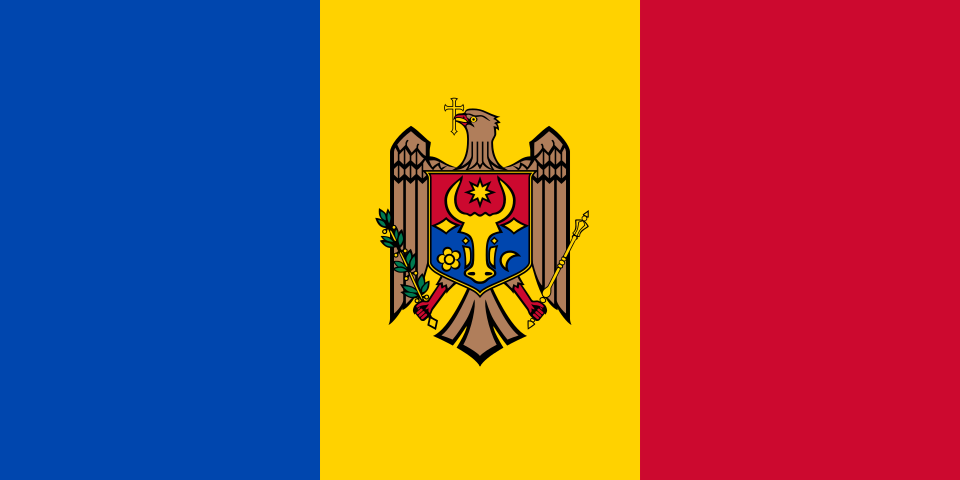
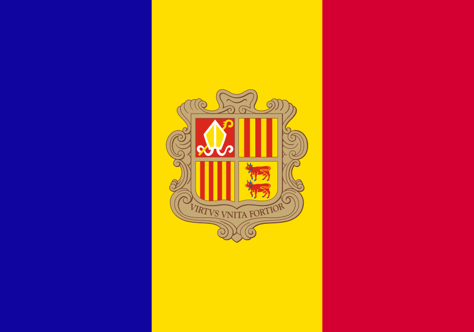
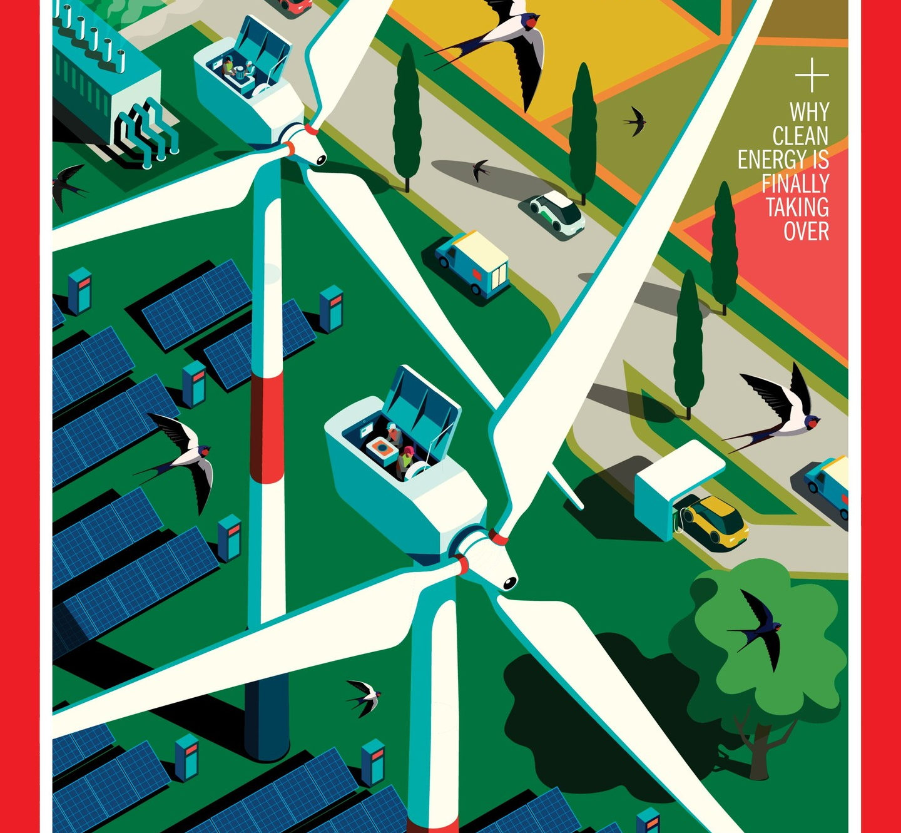

## {.vertical}

**Question 1**

What is the release date of the video game Grand Theft Auto VI produced by Rockstar Games?

::: {.bonus}
[Bonus.]{.bonus-tag} How many times was it delayed?
:::

::: {.score}
[2 points for <u>each</u> correct answer]
:::

::: {.footer}
C. General Knowledge
:::

## {.vertical}

**Question 2**

Name the two Marvel Cinematic Universe theatrical films, in full, with release dates in 2026.

::: {.score}
[2 points for <u>each</u> correct answer]
:::

::: {.footer}
C. General Knowledge
:::

## {.vertical}

**Question 3**

What does the acronym *DOGSO* stand for in a game of football (soccer)?

::: {.score}
[1 point for word <u>in its</u> correct position]
:::

::: {.footer}
C. General Knowledge
:::

## {.vertical}

**Question 4**

Which of these is *not* a recognised dog breed?

::: {.answers style="font-size: 0.9em;"}
a. German Wirehaired Pointer
b. Jack Russell Terrier
c. Norwegian Water Spaniel
d. Bernese Mountain Dog
:::

::: {.score}
[1 point]
:::

::: {.footer}
C. General Knowledge
:::

## {.vertical}

**Question 5**

The flags of Andorra, Côte d’Ivoire, Moldova, and Ireland are shown below. Match each of country to its respective flag ([A.]{.bonus-tag}--[D.]{.bonus-tag}) for your answer.

::: {.answers}
a. {.flag}
b. {.flag}
c. {.flag}
d. {.flag}
:::

::: {.score}
[1 point for <u>each</u> correct match]
:::

::: {.footer}
C. General Knowledge
:::

## {.vertical}

**Question 6**

Below are cropped covers of the latest issue of four magazines. Name the magazine, *not* what's on the cover.

::: {.answers}
a. {.magazine}
b. {.magazine}
c. {.magazine}
d. {.magazine}
:::

::: {.score}
[1 point for <u>each</u> correct answer]
:::

::: {.footer}
C. General Knowledge
:::

## {.vertical}

**Question 7**

Before producing world-famous sports cars, what type of vehicle did the Italian brand *Lamborghini* originally manufacture?

::: {.answers}
a. Delivery vans
b. Motorcycles
c. Tractors
d. Speedboats
:::

::: {.score}
[1 point]
:::

::: {.footer}
C. General Knowledge
:::

## {.vertical}

**Question 8**

Where is Hawaiian pizza widely credited as having been invented?

::: {.answers}
a. Hawaii, USA
b. Campania, Italy
c. Queensland, Australia
d. Ontario, Canada
:::

::: {.score}
[1 point]
:::

::: {.footer}
C. General Knowledge
:::

## {.center style="text-align: center;"}

End of Round C

[← Back to all rounds](index.html)