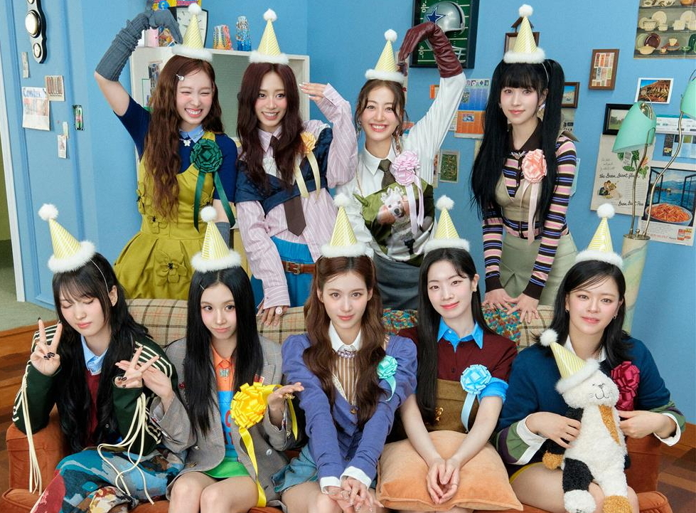

## {.vertical}

**Question 1**

What is the name of the longest national highway *and* which country is it found in?

::: {.score}
[2 points]
:::

::: {.footer}
D. Miscellaneous
:::

## {.vertical}

**Question 2**

Sydney has NightRide bus services throughout the week, for example, the N10, N20, ..., and N92. Starting with the N10, the general direction of each route from the CBD goes clockwise as the route number increases.

::: {style="text-align: center;"}
*True* or *False*?
:::

::: {.score}
[1 point]
:::

::: {.footer}
D. Miscellaneous
:::

## {.vertical}

**Question 3**

Which substitution (player on *and* player off) was the Socceroos’ final one against the Pharaohs in the FIFA World Cup Round of 32?

::: {.score}
[2 points]
:::

::: {.footer}
D. Miscellaneous
:::

## {.vertical}

**Question 4**

Which of the following K-pop acts have *not* toured Sydney in the past year (November 2025--2026)?

::: {.answers}
a. TWICE {width="55%"}
b. Stray Kids {width="55%"}
c. IVE {width="55%"}
d. BIGBANG {width="55%"}
:::

::: {.score}
[1 point]
:::

::: {.footer}
D. Miscellaneous
:::

## {.vertical}

**Question 5**

Which of the following is the final scoreline of the Kangaroos versus Kiwis match in the Rugby League World Cup?

::: {.answers}
a. 32--12
b. 34--10
c. 44--12
d. 20--18
:::

::: {.score}
[1 point]
:::

::: {.footer}
D. Miscellaneous
:::

## {.vertical}

**Question 6**

The sequence &#x1F411;&#x1F6BD;&#128004;&#x1F6BD; corresponds to which Sydney suburb?

::: {.score}
[2 points]
:::

::: {.footer}
D. Miscellaneous
:::

## {.vertical}

**Question 7**

Organise the following aquatic animals from longest to shortest (on average).

::: {.answers}
- Blue-ringed octopus
- Dugong
- Saltwater crocodile
- Yellowfin tuna
- Platypus
:::

::: {.score}
[1 point for <u>each</u> answer <u>in its</u> correct position]
:::

::: {.footer}
D. Miscellaneous
:::

## {.vertical}

**Question 8**

Name the city and country that are hosting the 2032 Summer Olympics.

::: {.score}
[2 points]
:::

::: {.footer}
D. Miscellaneous
:::

## {.center style="text-align: center;"}

End of Round D

[← Back to all rounds](index.html)